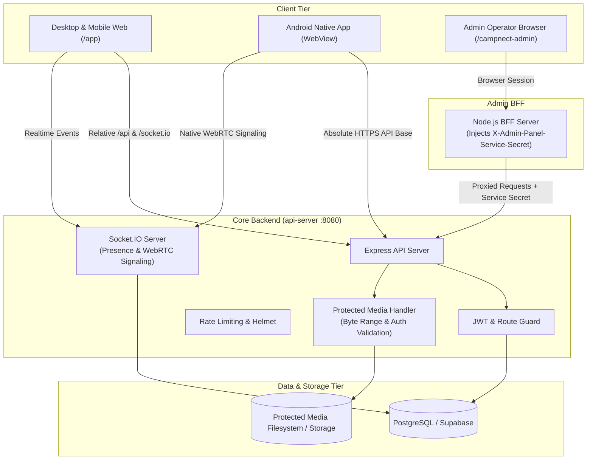

# Campnect 🎓

> A modern, verified campus social platform where students discover events, share Glimpses & Clips, connect with college communities, and chat in real-time.

---

## 📑 Table of Contents

- [Overview](#-overview)
- [Key Features](#-key-features)
  - [Campus Authentication & Verification](#campus-authentication--verification)
  - [Campus Feed & Social Graph](#campus-feed--social-graph)
  - [Glimpses (Campus Stories)](#glimpses-campus-stories)
  - [Clips (Short-Form Video)](#clips-short-form-video)
  - [Events & Campus Communities](#events--campus-communities)
  - [Realtime Chat, Presence & WebRTC Calls](#realtime-chat-presence--webrtc-calls)
  - [Protected Media Pipeline](#protected-media-pipeline)
  - [Push Notifications & Deep Linking](#push-notifications--deep-linking)
  - [Admin Console & Moderation](#admin-console--moderation)
  - [Dynamic Maintenance Mode](#dynamic-maintenance-mode)
- [Architecture & Monorepo Structure](#-architecture--monorepo-structure)
  - [Directory Layout](#directory-layout)
  - [Workspace Packages & Artifacts](#workspace-packages--artifacts)
- [Technology Stack](#-technology-stack)
- [System Design & Request Lifecycle](#-system-design--request-lifecycle)
  - [Browser Web Flow](#1-browser-web-flow)
  - [Production Autoscale Web Deployment](#2-production-autoscale-web-deployment)
  - [Native Android Architecture](#3-native-android-architecture)
  - [Admin BFF Security Boundary](#4-admin-bff-security-boundary)
- [Android Native Platform & Custom Plugins](#-android-native-platform--custom-plugins)
  - [Strict Android Back Navigation Contract](#strict-android-back-navigation-contract)
  - [Custom Java Plugins](#custom-java-plugins)
- [Environment Variables & Configuration](#-environment-variables--configuration)
- [Getting Started & Local Development](#-getting-started--local-development)
  - [Prerequisites](#prerequisites)
  - [Installation](#installation)
  - [Running the Services](#running-the-services)
  - [Building for Production](#building-for-production)
  - [Android Build Commands](#android-build-commands)
  - [Running Tests & Quality Checks](#running-tests--quality-checks)
- [Security & Invariants](#-security--invariants)
- [Troubleshooting Runbook](#-troubleshooting-runbook)
- [License](#-license)

---

## 🌟 Overview

**Campnect** is a full-featured, private-by-default social networking platform tailored for collegiate ecosystems. It bridges academic life and student culture by providing verified student identities, campus-restricted event management, real-time multimedia chat with peer-to-peer calling, ephemeral campus stories (**Glimpses**), algorithmic and chronological feeds, and short video reels (**Clips**).

The project is structured as a robust **pnpm monorepo** containing a React/Vite web application, a Node.js/Express backend with Socket.IO, an isolated Administrator Console with its own Backend-For-Frontend (BFF), and a Capacitor 8 Android application bundled with native Java plugins.

---

## 🚀 Key Features

### Campus Authentication & Verification
- **Student Email & OTP Onboarding**: Email/OTP validation with rate-limited signup and login mechanisms.
- **College Affiliation**: Discover and associate with specific universities and campuses.
- **College Verification Badges**: Verified student status badge system without blocking exploratory features.
- **Token Management**: JWT access tokens (24-hour expiration) with sliding refresh tokens (30-day expiration, UUID `jti` collision prevention) and client-side automatic Axios refresh interception.

### Campus Feed & Social Graph
- **Eligibility-First Chronological Feed**: Clean, unmanipulated chronological timeline with keyset pagination.
- **Rich Post Content**: Posts, threaded comments, reactions/likes, post saves, and link unfurling previews with bounded server-side scraping.
- **Profiles & Relationships**: Follows, followers, private account follow requests, close mates circles, and bi-directional blocking (preserving private history while disabling interactions).

### Glimpses (Campus Stories)
- **Interactive Story Surface**: Tap-through ephemeral media loop with username search and viewer tracking.
- **Dual-Action Camera Shutter**: Tap for photo capture, hold for video capture with client-side preview prior to upload.
- **Access Control**: Campus-scoped and follower-scoped visibility rules.

### Clips (Short-Form Video)
- **Protected Video Surface**: Continuous vertical feed of campus clips with audio retention.
- **Video Controls**: Autoplay muted with universal audio toggles and range-request video streaming.
- **Engagement**: Integrated likes, comments, and share flows.

### Events & Campus Communities
- **Campus-Bound Event Management**: Event creation, attendee RSVP lists, verification, and automated confirmation states.
- **Organized Communities**: Topic and club-based communities with discussion feeds, member roles, and community-level moderation.
- **Permissions**: Standard organizers are bound to their verified campus; elevated roles (`ceo`) can post cross-campus events.

### Realtime Chat, Presence & WebRTC Calls
- **Messaging**: 1-on-1 direct messaging, group chats, message requests, text, image, video, audio, and file attachments.
- **Reliability First**: REST acknowledgment is the authoritative source of truth for message delivery; Socket.IO is utilized for real-time fan-out.
- **Live Presence & Typing**: Granular typing indicators and online/last-seen status respecting user privacy settings.
- **WebRTC Voice & Video Calling**: Peer-to-peer audio and video calls coordinated via authenticated Socket.IO signaling.

### Protected Media Pipeline
- **Non-Public Storage**: Media files are not served as unauthenticated public static files; each asset is tracked in PostgreSQL and guarded by ownership and relationship checks.
- **Authenticated Blob Loading**: Frontend loads media as authenticated blobs into object URLs with placeholder fallback art.
- **Streaming Support**: Byte-range requests (`Accept-Ranges: bytes`) for smooth seeking on video and audio assets.

### Push Notifications & Deep Linking
- **OneSignal Push Service**: Native push notification subscriptions mapped to user profiles.
- **Preserved Deep Links**: Push payloads retain context (e.g. specific Post, Glimpse, or Clip ID) and navigate through normalized internal routes.

### Admin Console & Moderation
- **Dedicated Admin Console**: Completely separate administrator web app (`artifacts/campnect-admin`) running behind a secured BFF proxy.
- **Operations & Safety**: User moderation, account suspension/bans, post and comment takedowns, verification badge reviews, appeal processing, and tamper-resistant audit logs.

### Dynamic Maintenance Mode
- **Database-Backed Kill Switch**: Instant platform-wide maintenance toggle stored in PostgreSQL.
- **Seamless Recovery**: Frontend continuously polls `/api/maintenance`. Operators can bypass the maintenance gate through the Admin BFF to conduct maintenance or re-enable the platform.

---

## 🏛 Architecture & Monorepo Structure

### Directory Layout

```text
├── android/                         # Native Android Gradle project (Capacitor 8)
│   ├── app/src/main/java/com/campnect/app/  # Native Java plugins & back dispatcher
│   └── app/build.gradle             # Android build configuration
├── artifacts/
│   ├── campnect/                    # Primary production React/Vite web application
│   ├── api-server/                  # Production Express API, Socket.IO, and DB layer
│   ├── campnect-admin/              # Standalone Admin Web Console + Node.js BFF proxy
│   ├── campnect-app/                # Legacy reference frontend source
│   ├── campnect-desktop/            # Desktop client configuration
│   ├── campnect-legal/              # Legal, Terms of Service, and Privacy documents
│   └── mockup-sandbox/              # UI mockup and component preview workspace
├── lib/
│   ├── api-client-react/            # Generated React Query & custom Axios hooks
│   ├── api-spec/                    # OpenAPI 3.0 specification & Orval config
│   ├── api-zod/                     # Generated Zod validation schemas
│   └── db/                          # Database connection and Drizzle schema contracts
├── docs/                            # Feature specs, moderation guides, and threat models
├── scripts/                         # Build, deployment, and test runner scripts
├── capacitor.config.ts              # Capacitor app ID, status bar, and web directory config
├── package.json                     # Monorepo root scripts & tooling dependencies
├── pnpm-workspace.yaml              # Monorepo package workspace configuration
└── internaldocumentation.md         # Detailed internal engineering reference
```

### Workspace Packages & Artifacts

| Workspace Path | Package Name | Responsibility |
|---|---|---|
| `artifacts/campnect` | `@workspace/campnect` | Primary client app (React 19, Vite, Tailwind, Zustand) |
| `artifacts/api-server` | `@workspace/api-server` | Backend HTTP API, Socket.IO server, media handler |
| `artifacts/campnect-admin` | `@workspace/campnect-admin` | Admin dashboard and secure server-to-server BFF |
| `artifacts/campnect-legal` | `@workspace/campnect-legal` | Terms, Privacy Policy, and Student Code of Conduct |
| `lib/api-spec` | `@workspace/api-spec` | OpenAPI spec definition and Orval codegen tooling |
| `lib/api-client-react` | `@workspace/api-client-react` | Typed client hooks generated from API contracts |
| `lib/api-zod` | `@workspace/api-zod` | Zod validators shared across client and server |
| `lib/db` | `@workspace/db` | Database schema definitions |

---

## 💻 Technology Stack

### Frontend Web
- **Core**: React, TypeScript, Vite
- **Routing**: React Router (DOM)
- **State Management**: Zustand
- **Networking**: Axios (with custom bearer & token refresh interceptors), Socket.IO Client
- **UI Components & Utilities**: Tailwind CSS, CSS Custom Properties, Lucide React, `react-hot-toast`
- **Capacitor Core**: `@capacitor/core`, `@capacitor/camera`, `@capacitor/filesystem`, `@capacitor/push-notifications`

### Backend Services
- **Runtime**: Node.js
- **Web Framework**: Express
- **Real-Time Communication**: Socket.IO, WebRTC Signaling
- **Database Driver**: `pg` (PostgreSQL Client with SSL and connection pooling)
- **Authentication**: `jsonwebtoken` (JWT), `bcryptjs`
- **Security & Middleware**: `helmet`, `cors`, `express-rate-limit`, `pino` / `pino-http`
- **Media Processing**: `sharp`, ImageMagick / FFmpeg utilities

### Mobile (Android)
- **Framework**: Capacitor 8
- **Toolchain**: Java 21, Android Gradle Plugin, Android SDK 36 (Build-Tools 35+)
- **Push Provider**: OneSignal Capacitor SDK
- **Testing**: JUnit, Robolectric (for native bridge unit tests)

### Database
- **Engine**: PostgreSQL (accessed through Supabase transaction pooler)
- **Migration & Schema**: Raw idempotent SQL schemas (`schema.sql`, `recommendation-schema.sql`) with versioned checksum fingerprinting

---

## 🔄 System Design & Request Lifecycle



### 1. Browser Web Flow
1. Vite hosts `@workspace/campnect` (port `22821` locally).
2. The browser makes relative calls to `/api/*` and `/socket.io`.
3. An Axios interceptor automatically manages bearer tokens and handles non-blocking 401 refresh token rotations.
4. Protected media requests are converted to authenticated blob streams.

### 2. Production Autoscale Web Deployment
- Autoscale environments run a single unified HTTP process.
- During `pnpm run build:deploy`, the frontend bundle (`dist/public`) is copied directly into `artifacts/api-server/dist/public`.
- The Express API server serves `/api`, `/socket.io`, `/uploads`, and falls back to `index.html` for client-side React routes.

### 3. Native Android Architecture
- The Android app bundles the compiled web assets locally (`artifacts/campnect/dist/public`).
- It does **not** load the remote web root into the WebView, ensuring offline splash reliability and preventing placeholder screens.
- API traffic targets the remote production API via `VITE_API_BASE_URL` (`https://campnect.perinol.com/api`).

### 4. Admin BFF Security Boundary
- The operator signs into `/campnect-admin` and acquires an admin session token.
- The Admin Node server (`server.mjs`) proxies requests to `/api/*` and injects `X-Admin-Panel-Service-Secret`.
- The secret is strictly server-to-server and is **never** leaked or exposed to client JavaScript.

---

## 📱 Android Native Platform & Custom Plugins

### Strict Android Back Navigation Contract
Campnect enforces a bulletproof physical back-button contract to prevent unintended app exits and erratic routing.

```text
Android System Back Event
   │
   ▼
CampnectBackDispatcher (MainActivity)
   │
   ├── Validates Issued Event Identity & Nonce
   ├── Enforces Monotonic Lifecycle Generations
   └── Dispatches 'campnect:native-back' DOM Event
         │
         ▼
BackNavigationProvider (React Layer)
   │
   ├── Priority 1: Dismiss active temporary dialog / bottom sheet
   ├── Priority 2: Child routes navigate back via navigate(-1)
   └── Priority 3: Canonical Root (/feed, /search, /events, /glimpse, /clips, /profile)
         │
         ├── First Press  ──> NativeNavigationPlugin.armExit() ("Press again to exit")
         └── Second Press ──> NativeNavigationPlugin.exitApp() ──> Validates timing window & terminates
```

### Custom Java Plugins

| Plugin Class | Purpose |
|---|---|
| `CampnectBackDispatcher.java` | Centralized hardware/gesture Back coordinator with replay prevention |
| `NativeExitConfirmation.java` | High-precision two-event exit timing window and event lifecycle guard |
| `NativeNavigationPlugin.java` | Capacitor bridge for JavaScript back arming, cancelling, and exiting |
| `PhotoGalleryPlugin.java` | Direct access to native Android `MediaStore` for the recent photos picker in chat |
| `RuntimePermissionsPlugin.java`| Sequential runtime permissions bridge (Camera, Microphone, Notifications) |
| `SystemInsetsPlugin.java` | Accurate native system bar and cutout inset measurement |
| `CallAudioPlugin.java` | Audio device management during WebRTC calls (Speaker, Earpiece, Bluetooth) |

---

## 🔑 Environment Variables & Configuration

### Backend (`artifacts/api-server`)

| Variable | Required | Description |
|---|---|---|
| `DATABASE_URL` | **Yes** | Supabase/PostgreSQL connection string with SSL |
| `SESSION_SECRET` | **Yes** | Secret key for signing JWTs and refresh tokens |
| `PORT` | **Yes** | Port for the Express server (default `8080`) |
| `CAMPNECT_ORIGIN` | No | Allowed frontend origin for CORS and Socket.IO |
| `ADMIN_PANEL_ORIGIN` | No | Allowed origin for Admin Console operations |
| `ADMIN_PANEL_SERVICE_SECRET` | Conditional | Shared secret for Admin BFF verification |
| `TRUST_PROXY_HOPS` | No | Number of upstream reverse-proxy hops to trust (default `1`) |

### Admin BFF (`artifacts/campnect-admin`)

| Variable | Required | Description |
|---|---|---|
| `CAMPNECT_API_ORIGIN` | **Yes** | Upstream backend URL (e.g. `http://localhost:8080`) |
| `ADMIN_PANEL_SERVICE_SECRET` | **Yes** | Injected header value sent to the backend |
| `PORT` | No | Admin server port (default `20880`) |

### Frontend Client (`artifacts/campnect`)

| Variable | Required | Description |
|---|---|---|
| `VITE_API_BASE_URL` | No | Absolute API root for Android builds (e.g. `https://campnect.perinol.com/api`) |
| `PORT` | No | Vite development port (default `22821`) |

---

## 🛠 Getting Started & Local Development

### Prerequisites
- **Node.js**: v20.x or v22.x+
- **pnpm**: v9.x or v10.x (`corepack enable pnpm`)
- **Java JDK**: Version 21 (for Android builds)
- **Android SDK**: Platform 36, Build-Tools 35.0.0+

### Installation

Clone the repository and install all monorepo dependencies:

```bash
git clone https://github.com/Kenkei69/Campnect.git
cd Campnect
pnpm install
```

### Running the Services

Run each component in separate terminals:

```bash
# 1. Start the Core Backend API (port 8080)
pnpm --filter @workspace/api-server run dev

# 2. Start the Campnect Web Frontend (port 22821)
pnpm --filter @workspace/campnect run dev

# 3. (Optional) Start the Admin Console & BFF (port 20880)
pnpm --filter @workspace/campnect-admin run dev
```

### Building for Production

Compile all workspace packages, generate bundles, and package the static web app into the backend server:

```bash
# Typecheck and assemble production artifacts
pnpm run build:deploy

# Launch the unified production server
pnpm start
```

### Android Build Commands

```bash
# Verify Capacitor and native Android environment
pnpm run cap:doctor

# Sync compiled web assets to the Android native directory
pnpm run cap:build

# Build a standalone debug APK
pnpm run cap:apk:debug
# Output will be located at: android/app/build/outputs/apk/debug/app-debug.apk
```

### Running Tests & Quality Checks

```bash
# Full monorepo typecheck across all packages
pnpm run typecheck

# Run frontend navigation and Back-button regression test suite
pnpm --filter @workspace/campnect exec tsx --test src/navigation/*.test.ts

# Run API post count and engagement test suite
pnpm --filter @workspace/api-server run test:profile-posts-count

# Run Android native unit tests (Robolectric & JUnit)
bash android/gradlew -p android testDebugUnitTest --no-daemon
```

---

## 🛡 Security & Invariants

- **Fail-Closed Secrets**: The API will immediately exit at startup if `DATABASE_URL` or `SESSION_SECRET` is missing.
- **Strict Rate Limiting**:
  - General API: 500 requests per 15 min
  - Auth endpoints: 30 requests per 15 min
  - Login attempts: 10 requests per 15 min
  - Registration: 5 requests per hour
  - Protected media: 30 requests per 15 min
- **Safe Proxy Boundaries**: Bounded `trust proxy` prevents spoofed client IP bypasses of rate limiters.
- **Atomic Operations**: Database transactions (`withTransaction`) ensure media records, posts, and message associations commit simultaneously.
- **Media Authorization**: Assets are verified against session user permissions before streaming or sending byte chunks.

---

## 📖 Troubleshooting Runbook

| Symptom | Cause | Solution |
|---|---|---|
| **API health 500 on start** | Asynchronous database initialization or schema migration in progress | Inspect logs for Supabase pooler connectivity; wait a few moments for bootstrap completion. |
| **Blank web preview** | Wrong port or missing proxy header | Ensure Vite is running on port `22821` and accessible via relative URLs. |
| **Android login fails** | Missing `VITE_API_BASE_URL` at build time | Build with `VITE_API_BASE_URL=https://your-domain.com/api` before running `cap sync`. |
| **Media fails to load** | Direct `` pointing to protected endpoint | Use the authenticated blob loader (`useProtectedMedia`) rather than raw URLs. |
| **Admin panel 403 Forbidden** | Missing or mismatched `ADMIN_PANEL_SERVICE_SECRET` | Verify the BFF has the matching secret configured in the backend environment. |

---

## 📄 License

This project is licensed under the [MIT License](LICENSE).
